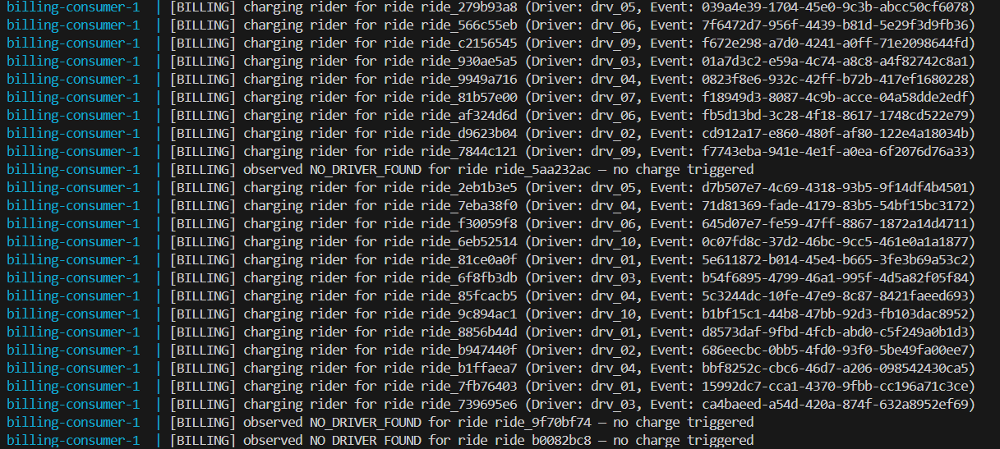
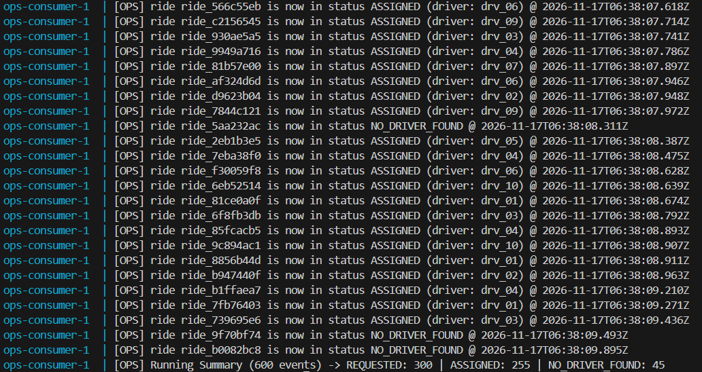

# Ride Booking & Asynchronous Dispatch System

A production-inspired, distributed ride-hailing dispatch engine built with **Node.js**, **TypeScript**, **Express**, **BullMQ**, and **Redis**. The system decouples non-blocking HTTP ride ingestion from concurrent background driver matching, enforces atomic distributed driver locks, and broadcasts state transitions via Redis Pub/Sub to independent downstream consumers.

## System Architecture

```text
┌───────────────────┐     1. POST /rides (202 Accepted)      ┌───────────────────┐
│   Client / Load   │ ─────────────────────────────────────► │   Express API     │
│      Test         │ ◄───────────────────────────────────── │  (src/api/server) │
└───────────────────┘     Idempotency-Key / SSE Stream       └─────────┬─────────┘
                                                                       │
                      ┌────────────────────────────────────────────────┤
                      │ 2. Persist state (REQUESTED)                   │ 3. Enqueue job
                      ▼                                                ▼
            ┌───────────────────┐                            ┌───────────────────┐
            │    Redis Store    │                            │   BullMQ Queue    │
            │  (ride:<rideId>)  │                            │ (dispatch-queue)  │
            └─────────▲─────────┘                            └─────────┬─────────┘
                      │                                                │
                      │ 4. Atomic SET NX lock +                        │
                      │    Lua release & state update                  ▼
            ┌─────────┴────────────────────────────────────────────────┴─────────┐
            │                 Concurrent Dispatch Worker Pool (x10)              │
            │                   (src/worker/dispatchWorker.ts)                   │
            └─────────────────────────────────┬──────────────────────────────────┘
                                              │
                                              │ 5. Publish RideEvent
                                              ▼
                               ┌─────────────────────────────┐
                               │ Redis Pub/Sub Fan-Out Bus   │
                               │   (ride-events-channel)     │
                               └──────────────┬──────────────┘
                                              │
                     ┌────────────────────────┴────────────────────────┐
                     ▼ (100% Broadcast)                                ▼ (100% Broadcast)
      ┌──────────────────────────────┐                  ┌──────────────────────────────┐
      │ Program A: Billing Consumer  │                  │ Program B: Ops Monitor       │
      │ (Idempotent charge on        │                  │ (Live state logging &        │
      │  ASSIGNED via Redis SET)     │                  │  running system tallies)     │
      └──────────────────────────────┘                  └──────────────────────────────┘
```

## Key Engineering Highlights

* **Non-Blocking Ingestion (`202 Accepted`):** `POST /rides` validates payloads via `zod`, saves initial state (`REQUESTED`), enqueues a dispatch job onto BullMQ, publishes a `REQUESTED` event, and responds immediately without blocking on driver negotiation.
* **Distributed Concurrency Safety:** Workers acquire short-lived locks (`SET driver:lock:<id> <rideId> PX 3000 NX`) before offering a ride to a driver and release them inside a `try/finally` block using an atomic Lua compare-and-delete script—preventing double-assignments across concurrent threads.
* **Deterministic Retry Cap:** Each ride tracks tried drivers in a `Set` so no driver is offered the same ride twice, capping attempts at **3 distinct rejections** before transitioning to `NO_DRIVER_FOUND`.
* **True Fan-Out & Idempotent Billing:** Redis Pub/Sub broadcasts every transition to both standalone consumers simultaneously. `billing-consumer` deduplicates events via `SADD billing:processed_events <eventId>` so riders are charged once and only on `ASSIGNED`.
* **Production Resilience & Observability:** Includes HTTP `Idempotency-Key` deduplication on `POST /rides`, a deterministic `?forceReject=true` chaos toggle for testing edge cases, and a zero-polling `GET /rides/:rideId/stream` Server-Sent Events (SSE) endpoint.

---

## Quick Start (Docker Compose)

Launch all 5 containers (`redis`, `api`, `worker`, `billing-consumer`, `ops-consumer`) with healthcheck-ordered startup:

```bash
# 1. Build and start the full stack in detached mode
docker compose up --build -d

# 2. Verify all 5 services are running
docker compose ps

# 3. Run the 100-ride concurrency & invariant verification suite
npm run test:load

# 4. Inspect independent fan-out logs across both consumers
docker compose logs billing-consumer --tail=25
docker compose logs ops-consumer --tail=25

# 5. Tear down containers when done
docker compose down
```

### Local Development (Without Docker for Node Services)

```bash
# Start Redis locally (or via Docker: docker run -d -p 6379:6379 redis:7-alpine)
npm install

# Run each service in a separate terminal
npm run dev:api
npm run dev:worker
npm run dev:billing
npm run dev:ops
```

---

## API Endpoints

### 1. Book a Ride (`POST /rides`)
Supports optional `Idempotency-Key` header deduplication and `?forceReject=true` (or `X-Simulate-Reject: true`) deterministic chaos testing.

```bash
curl -X POST http://localhost:3000/rides \
  -H "Content-Type: application/json" \
  -H "Idempotency-Key: booking-req-001" \
  -d '{
    "riderId": "rider_001",
    "pickupLocation": "Bandra West, Mumbai",
    "dropoffLocation": "Powai, Mumbai"
  }'
```

**Response (`202 Accepted` on creation, `200 OK` on idempotent replay):**
```json
{
  "rideId": "ride_9f3a1c2e",
  "status": "REQUESTED",
  "message": "Ride request accepted and queued for dispatch"
}
```

### 2. Inspect Ride & Dispatch Audit Trail (`GET /rides/:rideId`)
Returns current status, assigned driver, and every driver offer attempt with timestamps.

```bash
curl http://localhost:3000/rides/ride_9f3a1c2e
```

### 3. Live Ride Status Stream (`GET /rides/:rideId/stream`)
Opens a real-time **Server-Sent Events (SSE)** stream that pushes status updates (`REQUESTED` → `ASSIGNED` / `NO_DRIVER_FOUND`) without client polling and auto-closes once a terminal state is reached.

```bash
curl -N http://localhost:3000/rides/ride_9f3a1c2e/stream
```

### 4. Health Check (`GET /health`)
```bash
curl http://localhost:3000/health
```

---

## Verification & Benchmark Results

### 1. 100-Ride Concurrency & Invariant Verification (Task 3)
Firing 100 concurrent `POST /rides` requests confirms that all rides reach a terminal state (`83 ASSIGNED + 17 NO_DRIVER_FOUND = 100`) in **~7.65s** with **0 double-assignments** and **0 stuck rides**.


### 2. Independent Pub/Sub Fan-Out Proof (Task 2)
Both standalone subscribers receive 100% of published events independently without competing for messages:

#### Program A — Billing Consumer (Idempotent Event Processing)
Triggers rider charges exclusively on `ASSIGNED` events while safely ignoring `NO_DRIVER_FOUND` transitions.



#### Program B — Operations Monitor (Live State & Tally Tracking)
Logs every ride transition (`REQUESTED`, `ASSIGNED`, `NO_DRIVER_FOUND`) in real time and maintains running system totals.

