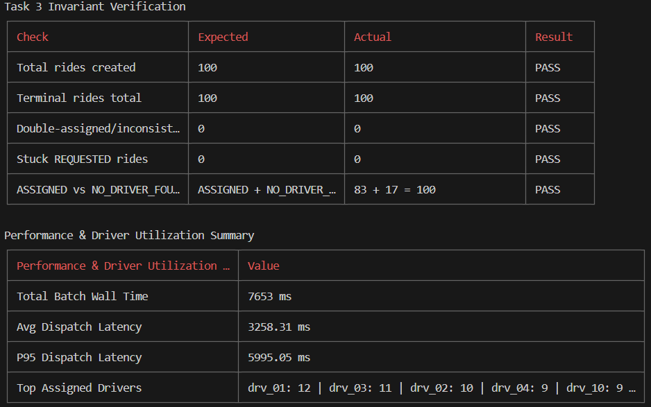

# Ride Dispatch System

An asynchronous ride-dispatch engine built with TypeScript, Express, BullMQ, Redis, and Docker Compose. Ride requests are accepted immediately, dispatched concurrently by workers, persisted in Redis, and broadcast to independent billing and operations consumers.

## Overview & Architecture

```text
                         POST /rides
                              |
                              v
                    +---------------------+
                    | Express API         |
                    | 202 Accepted        |
                    +----------+----------+
                               |
                 Ride state +  |  BullMQ job
                 audit trail   v
                    +----------+----------+
                    | Redis               |
                    | Ride store / Queue  |
                    +----------+----------+
                               |
                               v
                    +---------------------+
                    | Dispatch Queue      |
                    | BullMQ              |
                    +----------+----------+
                               |
                               v
              +-------------------------------+
              | Concurrent Worker Pool        |
              | Redis SET NX PX driver locks  |
              +---------------+---------------+
                              |
                 ASSIGNED / NO_DRIVER_FOUND
                              |
                              v
                    +---------------------+
                    | Redis Pub/Sub       |
                    | ride-events-channel |
                    +----------+----------+
                               |
                 +-------------+-------------+
                 v                           v
        +------------------+        +------------------+
        | Billing Consumer |        | Ops Consumer     |
        | Event-id SET     |        | Live metrics     |
        | idempotency      |        | and summaries    |
        +------------------+        +------------------+
```

## Key Engineering Highlights

- **Non-blocking ingestion:** `POST /rides` persists the ride, queues a dispatch job, publishes the initial event, and returns `202 Accepted` without waiting for a driver response.
- **Distributed concurrency safety:** workers claim drivers with atomic Redis `SET ... PX ... NX` locks. A Lua compare-and-delete release ensures a worker cannot release another worker's lock.
- **Bounded dispatch:** each ride tries distinct drivers and transitions to `NO_DRIVER_FOUND` after three rejections.
- **Broadcast fan-out:** Redis Pub/Sub delivers every event independently to Billing and Ops. Billing uses a Redis Set of event IDs for idempotent processing.
- **Operational visibility:** the operations consumer tracks status totals, while the load test verifies terminal-state and assignment invariants across 100 concurrent rides.

## Quick Start (Docker Compose)

Requirements: Docker Desktop with Compose and Node.js 20+ for the load test.

```bash
docker compose up --build -d
npm run test:load
docker compose logs billing-consumer ops-consumer
```

The Compose stack starts Redis, the API, the dispatch worker, the billing consumer, and the operations consumer. The load test targets `http://localhost:3000` by default; override it with `API_URL` when needed:

```bash
API_URL=http://localhost:3000 npm run test:load
```

Stop the stack with:

```bash
docker compose down
```

## Local Development (Without Docker for Node Services)

Run Redis separately on `localhost:6379`, then install dependencies and start each Node service in its own terminal:

```bash
npm ci
npm run dev:api
npm run dev:worker
npm run dev:billing
npm run dev:ops
```

The services load `.env` automatically. Useful variables include `REDIS_HOST`, `REDIS_PORT`, `PORT`, `WORKER_CONCURRENCY`, and `API_URL`.

## API Endpoints

### Health

```bash
curl http://localhost:3000/health
```

```json
{
  "status": "ok",
  "service": "ride-dispatch-api",
  "timestamp": "2026-11-17T06:20:00.000Z"
}
```

### Create a ride

```bash
curl -X POST http://localhost:3000/rides \
  -H "Content-Type: application/json" \
  -d '{
    "riderId": "rider_001",
    "pickupLocation": "Bandra West, Mumbai",
    "dropoffLocation": "Powai, Mumbai"
  }'
```

```json
{
  "rideId": "ride_7f3a12bc",
  "status": "REQUESTED",
  "message": "Ride booked and queued for dispatch"
}
```

### Get ride status

```bash
curl http://localhost:3000/rides/ride_7f3a12bc
```

```json
{
  "rideId": "ride_7f3a12bc",
  "riderId": "rider_001",
  "pickupLocation": "Bandra West, Mumbai",
  "dropoffLocation": "Powai, Mumbai",
  "status": "ASSIGNED",
  "assignedDriverId": "drv_04",
  "attempts": [
    {
      "attemptNumber": 1,
      "driverId": "drv_04",
      "driverName": "Sneha Patil",
      "accepted": true,
      "timestamp": "2026-11-17T06:20:00.300Z"
    }
  ],
  "createdAt": "2026-11-17T06:20:00.000Z",
  "updatedAt": "2026-11-17T06:20:00.300Z"
}
```

## Project Structure

```text
src/
  api/          Express server and ride routes
  config/       Redis configuration
  consumers/    Billing and operations Pub/Sub subscribers
  data/         Driver fixtures
  events/       Ride event publisher
  repositories/ Redis ride persistence and driver locks
  scripts/      Load and invariant verification test
  types/        Strict domain models
  worker/       BullMQ dispatch worker
```

## Verification & Benchmark Results

### 1. 100-Ride Concurrency & Invariant Verification (Task 3)
Firing 100 concurrent `POST /rides` requests confirms that all rides reach a terminal state (`83 ASSIGNED + 17 NO_DRIVER_FOUND = 100`) in **~7.65s** with **0 double-assignments** and **0 stuck rides**[cite: 4].



### 2. Independent Pub/Sub Fan-Out Proof (Task 2)
Both standalone subscribers receive 100% of published events independently without competing for messages[cite: 2, 3]:

#### Program A — Billing Consumer (Idempotent Event Processing)
Triggers rider charges exclusively on `ASSIGNED` events while safely ignoring `NO_DRIVER_FOUND` transitions[cite: 3].


#### Program B — Operations Monitor (Live State & Tally Tracking)
Logs every ride transition (`REQUESTED`, `ASSIGNED`, `NO_DRIVER_FOUND`) in real time and maintains running system totals[cite: 2].

